<!-- BANNER SUPERIOR -->

  

  <!-- SUBTÍTULO ANIMADO (TYPING SVG) -->
  

 

<!-- SECCIÓN SOBRE MÍ (PERSONALIZADA) -->
### ⚡ Sobre mí

Soy **Alfonso Durán**, estudiante de **Ingeniería Informática en la PUCV** (*Valparaíso, Chile*). Me gusta construir software de punta a punta: desde diseñar el modelo entidad-relación y prototipar la interfaz en **Figma**, hasta orquestar el backend en contenedores **Docker** y dejarlo corriendo en producción.

- 🃏 **Último proyecto en producción:** [**TCGStore**](https://proyecto-web-y-movil.vercel.app/) — E-commerce full-stack especializado en *Trading Card Games* (*Pokémon, Magic, One Piece, Digimon, Gundam, Riftbound*), construido con **Ionic + React 19 + TypeScript**, API REST en **Node.js/Express**, **PostgreSQL (Supabase)**, **Google OAuth 2.0**, contenedores **Docker Compose + Nginx** y desplegado en **Vercel & Render**.
- 🗄️ **Datos, Backend & ML:** Diseño de bases de datos relacionales, procesos **ETL**, análisis transaccional (**PostgreSQL WAL**, concurrencia y control de acceso RBAC) y entrenamiento de modelos de **Machine Learning** con *Scikit-Learn, Pandas y Jupyter*.
- 🎮 **Fuera de la terminal:** Cuando no estoy depurando un contenedor o afinando una query SQL, probablemente estoy recorriendo Night City en *Cyberpunk 2077*, en incursiones de *ARC Raiders*, automatizando fábricas en *Satisfactory*, jugando *Valorant* / *Age of Empires II* o coleccionando y armando mazos de cartas *TCG*.

---

<!-- CONECTAR Y PROYECTOS EN VIVO -->
### 🌐 Connect & Featured Work

  
  
  
  

---

<!-- LENGUAJES -->
### 💻 Languages

  
  
  
  
  
  
  
  

---

<!-- FRAMEWORKS, DATA & DEVOPS -->
### 🛠️ Full-Stack, Cloud & Data Ecosystem

**Frontend, Mobile & UI/UX**

  
  
  
  

**Backend, Databases & Cloud / DevOps**

  
  
  
  
  
  
  
  
  
  

**Data Science & Machine Learning**

  
  
  
  

---

<!-- JUEGO INFERIOR: PAC-MAN DEVORANDO CONTRIBUCIONES -->
### 👾 Contribution Arcade

  <picture>
    <source media="(prefers-color-scheme: dark)" srcset="https://raw.githubusercontent.com/QttSaed/QttSaed/output/pacman-contribution-graph-dark.svg" />
    <source media="(prefers-color-scheme: light)" srcset="https://raw.githubusercontent.com/QttSaed/QttSaed/output/pacman-contribution-graph.svg" />
    
  </picture>

<!-- PIE DE PÁGINA ONDULADO -->

  

